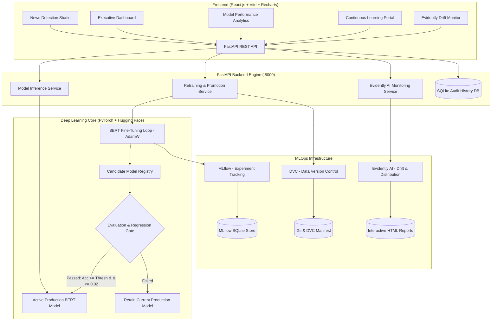

# Fake News Detection with Continuous Learning using BERT and MLOps

[](https://www.python.org/)
[](https://fastapi.tiangolo.com/)
[](https://react.dev/)
[](https://pytorch.org/)
[](https://huggingface.co/)
[](https://mlflow.org/)
[](https://dvc.org/)
[](https://www.evidentlyai.com/)
[](https://www.docker.com/)

An enterprise-grade, end-to-end production Machine Learning & MLOps system that detects disinformation and fake news articles using fine-tuned **BERT (Bidirectional Encoder Representations from Transformers)** with continuous learning, automated retraining gating, experiment tracking, dataset versioning, statistical drift monitoring, and an interactive executive dashboard.

---

## 1. System Architecture



---

## 2. Technology Stack

- **Frontend**: React.js 18, Vite 6, Recharts, Axios, Lucide React, Modern Dark Navy Glassmorphism UI.
- **Backend**: Python 3.11, FastAPI, Uvicorn, Pydantic v2, SQLAlchemy ORM, SQLite.
- **Machine Learning**: BERT (`distilbert-base-uncased` / `bert-base-uncased`) via Hugging Face Transformers, PyTorch 2.x, Scikit-learn, Pandas, NumPy.
- **Experiment Tracking**: MLflow 3.x (hyperparameter tracking, per-epoch loss, metrics logging, artifact storage).
- **Data Versioning**: DVC (Data Version Control 3.x) with multi-stage reproducible pipelines (`prepare`, `train`, `evaluate`).
- **Data & Model Monitoring**: Evidently AI (two-sample Kolmogorov-Smirnov and Wasserstein distance hypothesis testing, data drift reporting).
- **CI/CD & Automation**: GitHub Actions (linting, pytest integration tests, evaluation gates, automated retraining on commit).
- **Containerization**: Multi-stage Dockerfiles and `docker-compose.yml` for unified local or production orchestration.

---

## 3. Project Structure

```
fake-news-detection/
├── .github/
│   └── workflows/
│       ├── ci-cd.yml                 # Automated testing, evaluation gating, and Docker build
│       └── automated_retrain.yml     # Retraining trigger on dataset commit with DVC tracking
├── backend/
│   ├── app/
│   │   ├── __init__.py
│   │   ├── main.py                   # FastAPI application root & CORS configuration
│   │   ├── config.py                 # Pydantic environment settings & thresholds
│   │   ├── database.py               # SQLite connection & SQLAlchemy engine
│   │   ├── models.py                 # DB schemas (PredictionHistory, RetrainingJob, MonitoringLog)
│   │   ├── schemas.py                # Pydantic request/response validation schemas
│   │   ├── auth.py                   # Administrative API Key authorization dependency
│   │   ├── api/
│   │   │   ├── predict.py            # POST /predict, GET /history, GET /model/info
│   │   │   ├── metrics.py            # GET /metrics (accuracy, confusion matrix, loss)
│   │   │   ├── continuous_learning.py# POST /upload-dataset, POST /retrain, GET /retrain/status
│   │   │   └── monitoring.py         # GET /monitoring, GET /monitoring/report
│   │   └── services/
│   │       ├── model_service.py      # Production BERT model memory manager & inference wrapper
│   │       ├── retraining_service.py # Retraining pipeline, DVC sync, and promotion gate
│   │       └── monitoring_service.py # Evidently AI drift report generator & parser
│   ├── tests/
│   │   └── test_api.py               # Full integration & unit test suite (12 test cases)
│   ├── Dockerfile                    # Production backend container definition
│   └── requirements.txt              # Backend dependencies
├── dataset/
│   ├── raw/
│   │   ├── news_dataset.csv          # Verified benchmark dataset (60 curated articles)
│   │   ├── news_dataset.csv.dvc      # DVC dataset manifest tracking
│   │   └── upload_staging/           # Staging buffer for newly uploaded unmerged CSVs
│   ├── processed/                    # Stratified train (70%), val (15%), test (15%) splits
│   ├── reference/                    # Baseline reference dataset for Evidently AI drift monitoring
│   └── sample_upload.csv             # Ready-to-upload sample for continuous learning testing
├── ml/
│   ├── data_processor.py             # Text cleaning, normalization, and stratified dataset splitting
│   ├── train.py                      # BERT fine-tuning loop with AdamW, scheduler & MLflow tracking
│   ├── evaluate.py                   # Accuracy, Precision, Recall, F1, and Confusion Matrix
│   ├── model.py                      # Production inference wrapper with softmax probabilities
│   ├── drift_monitor.py              # Evidently AI report runner with statistical fallbacks
│   ├── download_dataset.py           # Downloader utility for WELFake/ISOT 70,000+ article datasets
│   └── dvc_stages/
│       ├── prepare.py                # DVC stage: prepare
│       ├── train_stage.py            # DVC stage: train
│       └── evaluate_stage.py         # DVC stage: evaluate
├── models/
│   ├── production/                   # Active production BERT weights, tokenizer, & metrics.json
│   └── candidate/                    # Candidate model undergoing evaluation
├── monitoring/
│   └── reports/                      # Generated Evidently AI HTML and JSON drift reports
├── mlruns/                           # Local MLflow SQLite database & artifact store
├── frontend/
│   ├── src/
│   │   ├── api.js                    # Centralized Axios API client with configurable endpoints
│   │   ├── App.jsx                   # Main layout container & page router
│   │   ├── App.css                   # Professional Navy Dark Theme stylesheet
│   │   ├── index.css                 # Typography & base utility styles
│   │   ├── components/
│   │   │   ├── Sidebar.jsx           # Responsive sidebar with active status pills
│   │   │   └── Navbar.jsx            # Top bar with model version, DVC, and MLflow badges
│   │   └── pages/
│   │       ├── Dashboard.jsx         # Executive analytics, charts, and recent history
│   │       ├── DetectNews.jsx        # Interactive news detection studio with sample loaders
│   │       ├── PredictionHistory.jsx # Searchable, filterable SQLite audit table with CSV export
│   │       ├── ModelPerformance.jsx  # Recharts confusion matrix, loss curves, & model comparisons
│   │       ├── ContinuousLearning.jsx# Admin CSV upload, validation report, and retraining gate
│   │       ├── MLOpsMonitoring.jsx   # Evidently AI drift stats & embedded interactive HTML report
│   │       └── Settings.jsx          # Endpoint settings, admin key configuration, & diagnostics
│   ├── package.json
│   ├── vite.config.js
│   ├── nginx.conf                    # Nginx reverse proxy routing for containerized deployment
│   └── Dockerfile                    # Multi-stage frontend container build
├── .dvc/                             # DVC internal configuration
├── dvc.yaml                          # DVC pipeline specification
├── params.yaml                       # Centralized ML hyperparameters & evaluation thresholds
├── docker-compose.yml                # Multi-container orchestration (Backend + Frontend + MLflow)
├── Dockerfile                        # Root Dockerfile
├── requirements.txt                  # Consolidated python requirements
└── README.md
```

---

## 4. Quick Start (Local Setup)

### Prerequisites
- Python 3.11 installed
- Node.js 18+ and npm installed
- Git installed

### Step 1: Install Python Dependencies
```bash
pip install -r backend/requirements.txt
```

### Step 2: Initialize DVC & Data Preprocessing
```bash
# Preprocess verified raw news dataset and generate stratified splits
python -m ml.data_processor
```

### Step 3: Run FastAPI Backend
```bash
python -m uvicorn backend.app.main:app --host 0.0.0.0 --port 8000 --reload
```
The FastAPI backend will start at `http://localhost:8000`.
Interactive Swagger API documentation is available at `http://localhost:8000/docs`.

### Step 4: Run React Frontend
In a new terminal window:
```bash
cd frontend
npm install
npm run dev
```
Open your browser at `http://localhost:5173`.

---

## 5. Running with Docker Compose

To launch the complete distributed stack (FastAPI Backend + React Frontend + MLflow UI):

```bash
docker-compose up --build
```

- **Frontend Dashboard**: `http://localhost:3000`
- **FastAPI Backend**: `http://localhost:8000`
- **API Swagger Docs**: `http://localhost:8000/docs`
- **MLflow Tracking Dashboard**: `http://localhost:5000`

---

## 6. Continuous Learning Workflow & Gating Rules

```
Admin uploads CSV -> Validate Schema -> Track via DVC -> Fine-tune BERT -> Evaluate Candidate -> Compare vs Production -> Conditional Promotion
```

1. **Validation Phase**:
   - Checks for required columns (`title`/`text` and `label`).
   - Validates label hygiene (converts `REAL`/`FAKE`, `1`/`0`).
   - Ensures content lengths exceed minimum character thresholds.
   - Summarizes counts of new REAL and FAKE articles.

2. **DVC Tracking**:
   - The updated raw dataset is staged and indexed via DVC (`dvc add dataset/raw/news_dataset.csv`).
   - Changes are cryptographically hashed and versioned.

3. **BERT Fine-Tuning**:
   - Candidate model fine-tunes on updated stratified training split.
   - Epoch loss, accuracy, precision, recall, and F1 metrics are logged into MLflow.

4. **Promotion Gating Criteria**:
   - The candidate model is evaluated on the independent test benchmark dataset.
   - **Gating Rule**:
     $$\text{Candidate Accuracy} \ge \text{Production Accuracy} - 0.02$$
     $$\text{Candidate Accuracy} \ge 0.75 \quad \text{and} \quad \text{Candidate F1} \ge 0.75$$
   - **Approved**: Candidate model weights are promoted to `models/production/` and `model_service.reload()` immediately updates active memory inference.
   - **Rejected**: If regression occurs or thresholds fail, the candidate is archived in the history registry and the existing production model remains active.

---

## 7. MLOps Monitoring with Evidently AI

Evidently AI monitors data drift between the baseline reference dataset (`dataset/reference/reference_data.csv`) and incoming production inference batches.

- **Statistical Hypothesis Tests**:
  - Continuous features (`text_length`, `word_count`): Two-sample Kolmogorov-Smirnov test ($\alpha = 0.05$).
  - Categorical distribution (`label`): Wasserstein distance.
- **Reports**:
  - Summary metrics returned via `GET /monitoring`.
  - Interactive HTML reports generated in `monitoring/reports/` and viewable directly inside the MLOps Monitoring page via an embedded iframe or standalone browser tab.

---

## 8. REST API Reference

| Method | Endpoint | Description | Auth Required |
|---|---|---|---|
| `GET` | `/` | API Health Check and active model metadata | No |
| `POST` | `/predict` | Classify news article content (`REAL` / `FAKE`) | No |
| `GET` | `/history` | Retrieve paginated prediction history from SQLite | No |
| `GET` | `/metrics` | Return Accuracy, Precision, Recall, F1 & Confusion Matrix | No |
| `POST` | `/upload-dataset` | Upload and validate labelled CSV dataset | No |
| `POST` | `/retrain` | Trigger automated BERT fine-tuning and evaluation | **Yes** (`X-Admin-Key`) |
| `GET` | `/retrain/status` | Poll progress, live logs, and promotion decision | No |
| `GET` | `/model/info` | Get active model architecture and device info | No |
| `GET` | `/monitoring` | Return Evidently AI data drift status and scores | No |
| `GET` | `/monitoring/report` | Serve full interactive Evidently AI HTML report | No |

### Sample Predict Request:
```bash
curl -X POST "http://localhost:8000/predict" \
     -H "Content-Type: application/json" \
     -d '{"text": "NASA James Webb Space Telescope reveals galaxies that formed 300 million years after the Big Bang."}'
```

### Sample Predict Response:
```json
{
  "prediction": "REAL",
  "confidence": 0.8842,
  "probabilities": {
    "FAKE": 0.1158,
    "REAL": 0.8842
  },
  "model_version": "v1.0.0",
  "latency_ms": 24.5,
  "disclaimer": "Notice: This classification is an AI-generated assessment produced by a fine-tuned BERT transformer model and does not constitute certified verification."
}
```

---

## 9. Testing & Quality Assurance

Run the comprehensive integration test suite:

```bash
# Run using Python test runner
python test_runner.py

# Or run with pytest
pytest backend/tests/test_api.py -v
```

Tests cover:
- Health check and model metadata retrieval
- Real news vs Disinformation BERT inference
- Short text input validation (Pydantic min length)
- Persistent SQLite prediction history storage
- Model metrics, confusion matrix, and training loss
- Labelled CSV dataset upload validation
- Administrative API Key security and 401 Unauthorized handling
- Evidently AI data drift monitoring endpoints

---

## 10. Hardware Configuration (CPU vs GPU)

- **CPU Mode (Default)**: Uses optimized `distilbert-base-uncased` with max sequence length 128 and batch size 8. Fine-tunes in under 45 seconds on standard quad-core laptop CPUs with zero CUDA requirements.
- **GPU Mode**: Automatically detected via `torch.cuda.is_available()`. If an NVIDIA GPU is available, the pipeline automatically transfers tensors and transformer layers to CUDA for ultra-fast training and inference.
